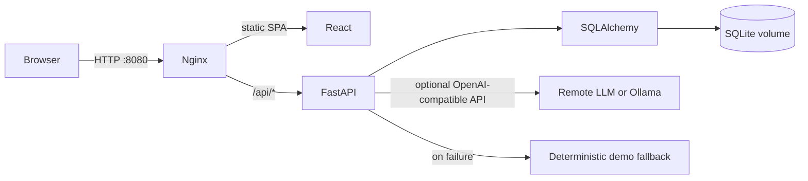
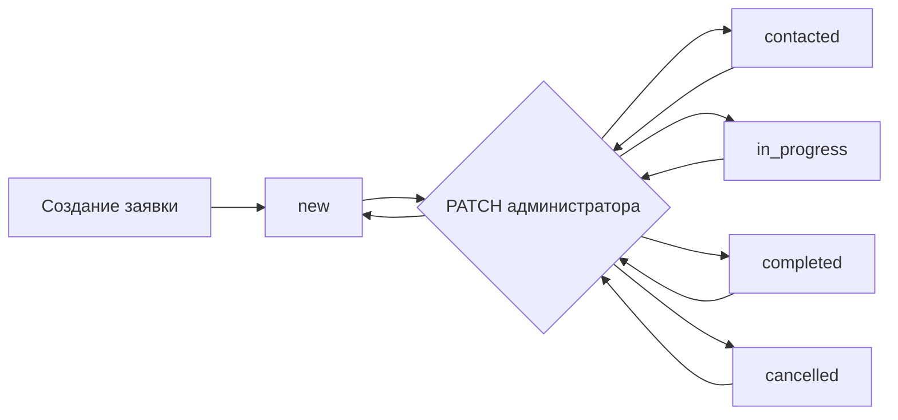
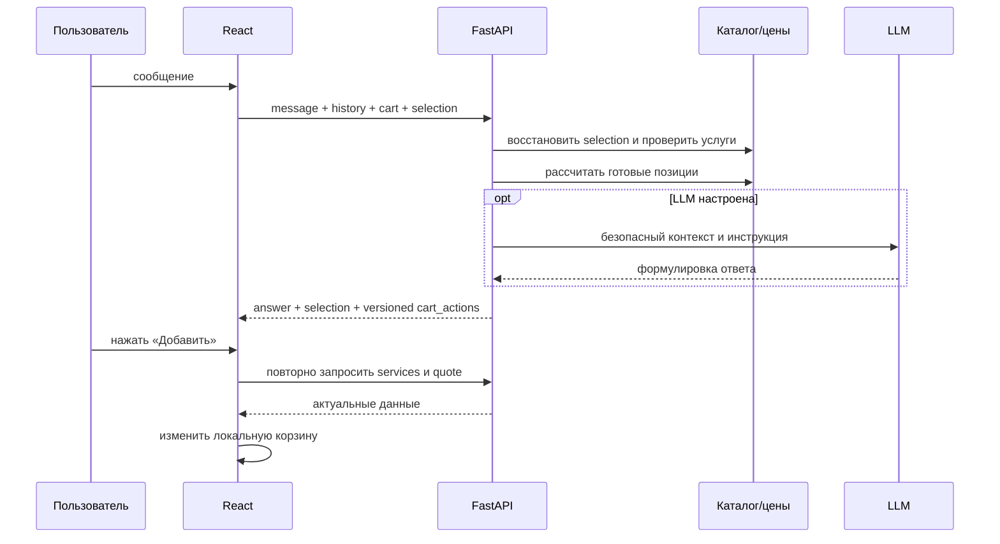
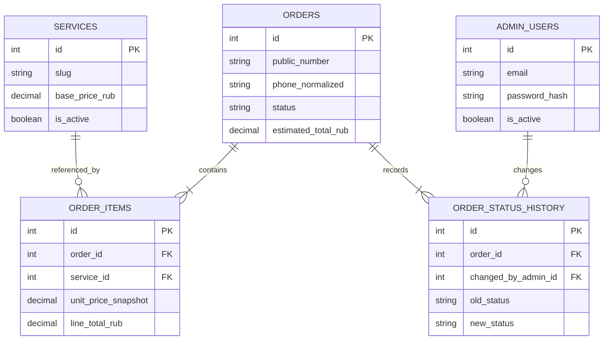

# Диаграммы

## Компоненты

## Жизненный цикл заявки

Backend хранит историю каждого фактического изменения, но текущий API разрешает администратору выбрать любое значение enum независимо от предыдущего статуса.

## Клиентский ИИ

## ER-модель

## CI/CD

```mermaid
flowchart LR
  F[Task branch] --> P[PR to dev]
  P --> C[CI + CodeQL]
  C -->|success + review| D[dev]
  D --> R[Release PR to main]
  R --> C2[CI]
  C2 --> M[main]
  M --> C3[push CI]
  C3 -->|verified SHA| CD[Production deploy]
  CD --> H[local + public healthchecks]
  H -->|failure| RB[rollback previous release]
```

